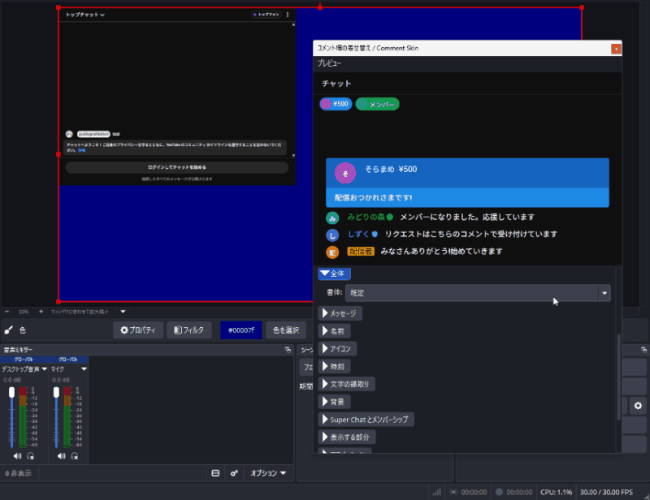

# コメント欄の着せ替え / Comment Skin

OBS Studio のブラウザーソースに表示した YouTube と Twitch のチャットの見た目を、ドックの設定から変えるプラグインです。CSS を書かずに、文字の大きさや色、背景、アイコン、アニメーションを配信画面に合わせられます。

A plugin for OBS Studio that restyles the YouTube and Twitch chat shown in a browser source from a dock, without writing CSS.

[配信プラグイン倉庫くん](https://soko-kun.allegromoltov.jp/plugins/allegromoltov/obs-comment-skin) にも掲載しています。 / Also listed on [Plugin Soko-kun](https://soko-kun.allegromoltov.jp/plugins/allegromoltov/obs-comment-skin?lang=en).



本プラグインは YouTube および Twitch とは提携しておらず、両社の承認を受けたものではありません。

This plugin is not affiliated with, endorsed by, or sponsored by YouTube or Twitch.

## Features / 機能

ドックで設定を変えると、プラグインが CSS を生成し、選んだブラウザーソースのカスタム CSS に書き込みます。ドックの上部のプレビューには、設定がすぐに反映されます。設定の項目は、ブラウザーソースの URL から判別したチャットの種類によって切り替わります。

### YouTube

- 全体: 書体
- メッセージ: 文字の大きさ、行の高さ、字間、文字の色、名前とコメント文の間の改行
- 名前: 文字の大きさ、文字の色、配信者・モデレーター・メンバーの色、配信者の名前の網掛け、バッジ、名前の後の「:」
- アイコン: 表示、大きさ、形
- 時刻: 表示、文字の大きさ、文字の色
- 文字の縁取り: 縁取り、縁の太さ、縁の色
- 背景: 全体の背景色と不透明度、メッセージの背景色、配信者・モデレーター・メンバーの背景色、メッセージの背景の不透明度と形
- Super Chat とメンバーシップ: 名前・金額と説明・本文の大きさと色、メンバーシップの背景
- 表示する部分: 上部の見出し、上部に並ぶ Super Chat のアイコン、下部のログインの欄、YouTube からの案内
- アニメーション: 新しいメッセージの現れ方、古いメッセージを消すまでの時間と消え方

### Twitch

- 全体: 書体
- メッセージ: 文字の大きさ、行の高さ、字間、文字の色、名前とコメント文の間の改行
- 名前: 文字の大きさ、Twitch の名前の色の利用、文字の色、配信者・モデレーター・VIP・サブスクライバーの色、バッジ、名前の後の「:」
- 文字の縁取り: 縁取り、縁の太さ、縁の色
- 背景: 全体の背景色と不透明度、メッセージの背景色、配信者・モデレーター・VIP・サブスクライバーの背景色、メッセージの背景の不透明度と形
- サブスクの通知: 文字の大きさ、文字の色
- 表示する部分: 上部の見出し、上部のランキング、下部の入力欄、チャットルームの案内
- アニメーション: 新しいメッセージの現れ方、古いメッセージを消すまでの時間と消え方

### 共通

設定に名前を付けてプリセットとして保存し、同じ種類のチャットの別のブラウザーソースへ読み込めます。数値の項目はスライダーで設定できます。スライダーの横の数値欄に直接入力することもできます。

ブラウザーソースのカスタム CSS のうち、本プラグインが書き換えるのは `/* comment-skin begin */` から `/* comment-skin end */` までの範囲だけです。範囲の外に書いた CSS はそのまま残ります。

本プラグインは外部と通信しません。チャットのページを読み込むのは、OBS Studio に標準で入っているブラウザーソースです。生成する CSS は、外部の資源を読み込む `@import` や `url()` を含みません。ドックのプレビューは、プラグインに同梱した見本のページを表示するもので、YouTube と Twitch のページを読み込みません。

## Installation / インストール

### Windows

OBS Studio 33.0.1 以降に対応しています。

1. OBS Studio を終了してください。
2. [Releases](../../releases) から Windows 用の ZIP ファイルをダウンロードし、展開してください。
3. エクスプローラーのアドレスバーへ `%PROGRAMDATA%` を入力し、Enter キーを押してください。
4. `obs-studio` フォルダーを開き、その中の `plugins` フォルダーを開いてください。存在しないフォルダーは順に作成してください。
5. 展開した `comment-skin` フォルダーを `plugins` へコピーしてください。管理者の許可を求められた場合は許可してください。
6. OBS Studio を起動し、メニューの「ドック」から「コメント欄の着せ替え / Comment Skin」を選んでください。

導入後の構成は次のとおりです。`comment-skin` フォルダーを二重に作らないでください。

```text
%PROGRAMDATA%\obs-studio\plugins\
└─ comment-skin\
   ├─ comment-skin.dll
   └─ data\
      ├─ locale\
      │  ├─ en-US.ini
      │  └─ ja-JP.ini
      └─ preview\
         ├─ twitch.html
         └─ youtube.html
```

ポータブル版の OBS Studio では、OBS Studio のフォルダーの `bin` や `data` と同じ階層に `plugins` フォルダーを作成し、`comment-skin` フォルダーをコピーしてください。

### macOS / Linux

ビルド済みのファイルは配布していません。後述の「ビルド」にしたがい、公開タグのソースからビルドしてください。macOS と Linux のビルドは GitHub Actions で確かめていますが、作者は実機での動作を確かめていません。Linux の Wayland の環境では、ドックのプレビューは表示されません。

## Usage / 使い方

1. チャットを表示するブラウザーソースを用意します。ドックの「新規作成…」で、YouTube は動画の URL か動画 ID から、Twitch はチャンネル名から、チャットのポップアウトを表示するブラウザーソースを現在のシーンに作れます。既存のブラウザーソースを使う場合は、URL を次の形にしてください。
   - YouTube: `https://www.youtube.com/live_chat?is_popout=1&v=<動画 ID>`
   - Twitch: `https://www.twitch.tv/popout/<チャンネル名>/chat?popout=`
2. ドックの「ブラウザーソース」で、そのソースを選びます。URL からチャットの種類が判別されます。判別できない URL では、「チャットの種類」で選んでください。
3. 設定を変えます。プレビューはすぐに変わり、実際のチャットにも自動で反映されます。
4. 元に戻すときは「元に戻す」を押します。本プラグインで変える前のカスタム CSS に戻り、設定も既定に戻ります。
5. 生成した CSS は「生成した CSS」を開くと確かめられ、「CSS をコピー」でクリップボードに写せます。

設定はブラウザーソースごとにシーンコレクションへ保存され、OBS Studio を起動し直しても残ります。

## Hidden Elements / 隠せる要素

「表示する部分」で、次の部分を隠せます。

- YouTube: 上部の見出し、上部に並ぶ Super Chat のアイコン、下部のログインの欄、「チャットへようこそ」などの YouTube からの案内
- Twitch: 上部の見出し、上部のランキング、下部の入力欄、チャットルームの案内

広告、商品の紹介、告知、バナー、固定されたメッセージ、メッセージの中のリンクを隠す設定は用意していません。広告と帰属表示を隠さないためです。

YouTube および Twitch の利用規約は、サービスの改変について定めています。本プラグインで見た目を変えることについて、各サービスの規約に照らした可否の判断は、利用者の責任で行ってください。

## Known Behavior / 既知の挙動

- 設定が実際のチャットに反映されるたびに、ブラウザーソースはチャットのページを読み込み直します。そのとき、表示中のコメントは一度消えます。配信中に設定を変える場合は、この挙動に注意してください。
- 書体の候補は、利用者の PC に入っている書体です。日本語の文字を含まない書体を選ぶと、日本語の名前やコメントは別の書体で表示されます。
- 文字の大きさや字間、アイコンをとても大きくし、ブラウザーソースの幅が狭いときは、コメントの右端が欠けることがあります。日本語の禁則処理により、行の先頭に置けない文字が前の文字と一緒に送られるためです。
- Twitch の配信者・モデレーター・VIP・サブスクライバーは、名前の前のバッジの画像で見分けます。バッジの画像が変わると、色分けが効かなくなることがあります。
- YouTube と Twitch のチャットのページの作りが変わると、一部の設定が効かなくなることがあります。

## Build / ビルド

### Requirements / 必要環境

| Platform | Tool |
|----------|------|
| Windows | Visual Studio 2026、CMake 3.28 以降 |
| macOS | Xcode 26、CMake 3.28 以降 |
| Ubuntu 26.04 | ninja-build、pkg-config、build-essential、CMake 3.28 以降 |

### Build Commands / ビルドコマンド

```bash
# Windows
cmake --preset windows-x64 -DENABLE_POST_BUILD_INSTALL=OFF
cmake --build --preset windows-x64

# macOS
cmake --preset macos
cmake --build --preset macos

# Ubuntu
cmake --preset ubuntu-x86_64
cmake --build --preset ubuntu-x86_64
```

Windows で生成物を取り出すには、`cmake --install build_x64 --config RelWithDebInfo --prefix release/RelWithDebInfo` を実行してください。生成した `comment-skin` フォルダーを、前述の手順で導入してください。

単体テストは、`-DENABLE_TESTS=ON` を付けて構成し、ビルドした後に `ctest --test-dir build_x64 -C RelWithDebInfo` で実行できます。

## AI利用開示 / AI Disclosure

### 日本語

v1.0.0 までの制作では、Anthropic Claude Code を、調査、ソースコード、ビルド設定、テスト、文書、ロゴを含むほぼすべての工程で使用しました。

作者本人は Windows の OBS Studio でユーザーテストを実施しました。コード読解による厳密な人間レビューは実施していません。ロゴは Claude Code が出力した SVG を作者が選んだものです。説明の画像のアニメーション GIF は、作者本人が画面収録したもので、生成 AI を使用していません。

### English

Anthropic Claude Code was used for almost the entire development process up to v1.0.0, including research, source code, build configuration, tests, documentation, and the logo.

The author performed user testing in OBS Studio on Windows but did not perform a rigorous human review of the source code. The logo is an SVG generated by Claude Code and selected by the author. The animated GIF in the description was screen-recorded by the author, without generative AI.

## License / ライセンス

GPL-2.0 License

このプラグインは [obs-plugintemplate](https://github.com/obsproject/obs-plugintemplate) をベースにしています。ドックのプレビューは、[obs-browser](https://github.com/obsproject/obs-browser) のパネルの API を使います。そのヘッダーを `deps/obs-browser/` に同梱しています。

## Author / 作者

AllegroMoltoV - https://www.allegromoltov.jp

## Changelog / 更新情報

### v1.0.0

- 正式版です。プラグインの動作は v0.1.0 から変わりません。
- README に、配信プラグイン倉庫くんの掲載のページへのリンクを加えました。

### v0.1.0

- 最初の公開版です。YouTube と Twitch のチャットに対応しました。
